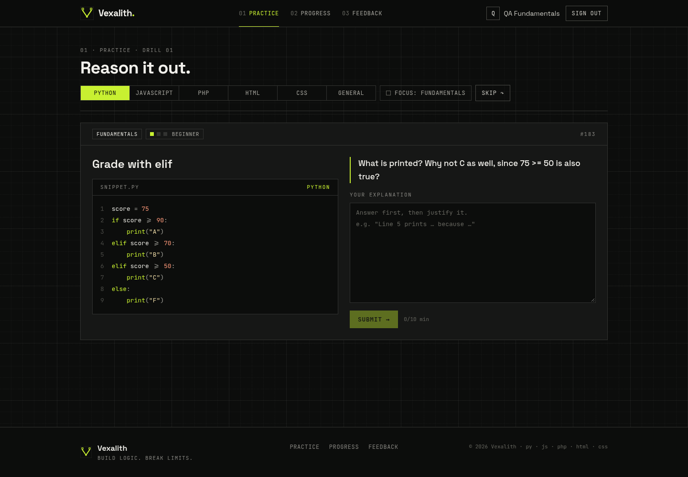

<p align="center">
  
</p>

<h1 align="center">Vexalith</h1>
<p align="center"><strong>Build Logic. Break Limits.</strong></p>

Vexalith is a free practice app for learning to think like a programmer.
You read a short piece of code, explain what it does, and get feedback on your answer.
It checks two things: whether your answer is right, and whether your reasoning makes sense.

**Live demo:** <https://vexalith-app.vercel.app>



## What you can practice

**Languages**

- Python
- JavaScript
- PHP
- C++ (modern C++17: from your first `cout` to pointers, classes, the STL and smart pointers)
- Java (modern Java 17: from your first `System.out.println` to `String` vs `.equals()`, collections, exceptions and OOP)
- HTML
- CSS
- General (no code needed: logic puzzles, binary numbers, step-by-step problem solving)

**Topics** (each has 3 levels: beginner, intermediate, advanced)

- **Fundamentals**: the basics, from your very first variable. New learners start here.
- **Code tracing**: predict what the code prints.
- **Debugging**: find the mistake and fix it.
- **Edge cases and testing**: find the input that breaks the code.
- **Code review**: suggest how to make the code better.
- **Data structures**: pick the right container (list, dictionary, set and more).
- **Object-Oriented Programming (OOP)**: classes, constructors, encapsulation (`private`/`public`, getters/setters), inheritance (`super`/`extends`), polymorphism, abstract classes vs interfaces, `static` vs instance members, and composition vs inheritance.
- **Algorithmic thinking**: how fast is the code? Can it be faster?
- **Algorithms**: classic problems such as searching and sorting.
- **Logic problems**: true/false puzzles and reasoning.

**Two kinds of questions**

- **Explain it**: read the code and say what it does and why (most questions).
- **Fill in the missing code**: part of the code is hidden behind a highlighted **?** slot. Type the line, expression, tag or property that belongs there. Equivalent answers count (spacing, quote style and a trailing `;` don't matter), so `i<3;` is as good as `i < 3`.

There are also plenty of **loop** drills in every language: `for`, `while`, `do-while`, nested loops, `break` and `continue`, "what does this print?" and off-by-one bugs.

There are 536 questions in total across 8 language tracks and 10 skill domains, including 67 for Java, 79 for C++, 58 Object-Oriented Programming questions, 56 fill-in-the-missing-code questions and 33 loop drills.

## How it works

1. **Sign in** with GitHub or Google.
2. **Pick a language and a level.** If you are new, you start with Fundamentals at level 1.
   The **Level** switch under the languages has four choices:
   - **Adaptive** (the default): the app picks the level from your results.
   - **Beginner**, **Intermediate** or **Advanced**: you only get questions at that level.
   You can also filter by **Topic** (such as **OOP**, **Fundamentals**, **Debugging** or **Data Structures**) using the Topic row under the level selector. Your choices are remembered as you skip or advance.
3. **Answer in your own words.** Say what the code does and why.
   Every question is written in plain words and ends with a **Your task** line that says exactly what to do
   (for example *"write the exact output first, then say why, pointing at the lines that cause it"*). Above the
   answer box, the small **How to answer** box adds only what the task line doesn't: what to look for in the code
   and, for fill-in-the-missing-code questions, what counts as a right answer. You can fold it away.
   Write the way you talk. The grader understands casual answers: contractions (*doesn't*, *didnt*), everyday
   words (*"it spits out five"*, *"cuz"*, *"the loop never ends"*), number words and small typos (*"varible"*).
   A casual answer with the right ideas scores about the same as a polished one; an answer that is off topic still fails.
   You can write in **English, Filipino (Tagalog) or Taglish** (a mix of both), for example:
   *"Nagpi-print siya ng 5 kasi copy lang ng value ang nakuha ng y."*
   The grader checks your ideas, not your language, so the same explanation gets about the same score in any of the three.
   Keep code (like `i < 5` or `acc.append(x)`) as you would type it.
   Stuck? Press **Show hint**. Every question has 3 hints, shown one at a time: first a way to approach it, then the key idea, then the point your answer must make. Each hint takes 10% off that answer's score (30% at most).
4. **Read your feedback.** It is written like a friendly tutor talking to you ("You're on the right track. You got 1 of the 3 key points..."). Right or wrong, you get an explanation: the key concept, one checklist of everything a full answer covers (ticked where you got it, open where something is still missing), any common mistake you made and why it's wrong, and the model answer. Points already shown in the checklist aren't repeated in the other notes. For fill-in-the-missing-code questions you also see the correct code.
   If you answered in Filipino or Taglish, the feedback says so ("Tinanggap ang sagot mo sa Filipino") and its headings switch to Filipino. Use the **English / Filipino** switch on the feedback to choose; your browser remembers it. The rubric points and the model answer stay in English.

The app adapts to you. It gives you more questions on the skills you find hardest, and harder questions as you improve.
Once you have cleared Fundamentals, every topic opens up.
Turn on **Focus: Fundamentals** on the practice page if you only want the basics.

**Daily challenge.** Open **Daily** in the menu. There is one question a day, the same for everyone. It changes at midnight Manila time (Asia/Manila, UTC+8), and the language changes every day. Answer it to complete the day. Do it on consecutive days to build a **streak**; your current and best streak appear on the Daily and Progress pages.

**Your progress page** shows:
- how many questions you solved, your accuracy and your average score;
- a chart of your score over the last 30 days, with how much you improved;
- your mastery per skill (with how many attempts) and per language;
- your recent answers;
- your daily streak, plus how many questions you skipped and how many hints you used.

**Recommended for you.** Your progress page (and the home page, once you are signed in) suggests what to do next:
- your 3 weakest skills, each with a **Practise** button that opens questions on just that topic;
- a few questions you haven't seen yet, at a level that suits you;
- any language where your average score is below your overall average.

## Write and run code

Open **Code** in the menu to write real code and test it. There are 57 small exercises:
12 in Python, 12 in JavaScript and 11 each in C++, Java and PHP. They go from
beginner (add up a list, reverse a word, FizzBuzz) to advanced (binary search, flatten nested lists).
Topics: loops, strings, conditions, lists and sets, dictionaries/maps, hash maps, math, recursion and searching.

1. Pick a language with the tabs at the top (your choice is remembered).
2. Open an exercise. **Your task** says what the function must do; the example tests show inputs and the right answers.
3. Write the function in the editor. Your draft is saved in your browser, and **Reset** brings back the starter code.
4. Press **Run my code** to run your code as a normal program and see what it prints, like on your own computer.
   You can write a `main()` or print at the top level. If your program reads input (`input()`, `Scanner`, `cin`,
   `readline()`, `prompt()`), type it in the **Input** box first, one line per answer.
5. Press **Run examples** (or Ctrl + Enter) to check your function against the example tests.
6. Press **Submit** to also run the hidden tests. Pass them all and the exercise is marked solved on your progress.

Everything shows up in the **Output** panel right under the editor:

- **Printed**: what your program wrote out. **Errors and warnings**: what it wrote to the error stream.
- If your code doesn't compile, or stops with an error, you see the message in plain words with the line number.
- For each example test you see **Expected** and **Got** side by side, plus anything you printed during that test.
- While a language engine downloads the first time, the panel shows a progress bar.

A test stops after 4 seconds (6 for Java) and a program after 10 seconds, so an endless loop can't freeze the page.

**Stuck? Use "How to solve it"** (under the example tests; on a phone it sits above the editor):

- **Hints**: up to 3, shown one at a time. The first is a nudge, the second the key idea, the third the technique to use.
  Each hint you open before passing takes 10% off the exercise's XP (see below).
- **Explanation**: opens by itself when you pass every test. It explains the problem in general terms, not line by line:
  *the idea* behind it, *the approach* in a few steps, *what to watch out for* (common mistakes and edge cases) and
  *the pattern* you can reuse on similar problems, plus a short reference solution to compare with yours.
- **Show solution**: opens the explanation and reference solution early. After you've run your code it opens straight away;
  before your first try it asks *"Are you sure?"* first. If you see the solution before passing, the exercise shows as
  **Solved with help**.

**Your code runs in your own browser, never on our server.** It's free for everyone: no paid services and no keys.
Each language's engine is downloaded from a public CDN only when you first pick that language, and your browser keeps it for next time:

| Language | Engine | Download the first time | License |
|---|---|---|---|
| JavaScript | your browser, in a locked-down Web Worker | nothing | – |
| Python | [Pyodide](https://pyodide.org) 0.29 (CPython in WebAssembly) | about 5 MB | MPL-2.0 |
| PHP | [php-wasm](https://github.com/seanmorris/php-wasm) 0.2 (PHP 8.4 in WebAssembly) | about 3 MB | Apache-2.0 (or GPL-2.0) |
| C++ | [YoWASP Clang](https://yowasp.org) (Clang/LLVM compiled to WebAssembly), C++17 | about 23 MB | ISC; LLVM is Apache-2.0 with LLVM exception |
| Java | [CheerpJ](https://cheerpj.com) 4.3 running OpenJDK's `javac` | about 20 MB | CheerpJ Community License (free for personal and open-source use, with credit); OpenJDK tools are GPL-2.0 with Classpath Exception |

How it stays safe and fast:

- JavaScript, Python and PHP run in a **Web Worker** (a background thread) with network access switched off
  (`fetch`, `XMLHttpRequest`, `WebSocket`, `importScripts` and similar are removed before your code starts).
- C++ is compiled to WebAssembly and run in its own worker. The program can only print; it gets no files or network.
- Java runs through CheerpJ in a hidden frame. Every loop gets a tiny time check, so an endless loop stops cleanly.
- **Each test has a time limit** (4 seconds, 6 for Java). If your code takes longer, it's stopped
  ("Is there a loop that never ends?") and the remaining tests are skipped.
- **Hidden tests stay secret.** Your browser only gets their inputs. It sends your outputs to the server,
  which compares them with the right answers it keeps to itself. `3.0` and `3` count as the same answer.

CheerpJ is made by [Leaning Technologies](https://leaningtech.com) and used here under its free
[Community License](https://cheerpj.com/docs/licensing). If you run a copy of Vexalith for a company, check that license first.

## Learning paths

Not sure what to practise next? Open **Paths** in the top bar and follow one. Each path is a short list of steps,
from beginner to advanced. A step is a handful of questions on one theme, often with a coding exercise.

| Path | Steps |
|---|---|
| Programming Fundamentals (no single language needed) | 4 |
| Web Basics (HTML and CSS) | 6 |
| Python, JavaScript, C++, Java, PHP | 7 each |
| Object-Oriented Programming | 4 |
| Logic & Algorithms | 5 |

- **Finishing a step:** score 75% on its questions (your best answers count, up to 4 questions) and pass its exercise, if it has one.
- **Opening the next step:** 75% on the questions *or* the exercise passed is enough.
- **Skip ahead:** you can open any locked step early. The step says you skipped ahead, and earlier steps stay open.
- Questions inside a step are picked by the same engine as Practice, and graded the same way.
- Answers and exercises you did before paths existed count, so you may already be part of the way along.
- **Continue where you left off** on the home and Progress pages takes you back to your step.
- **XP:** +25 for each step you finish and +100 for a whole path. Three badges go with them:
  **Trailhead** (your first step), **Path Finisher** (a whole path) and **Wayfinder** (three paths).

## Review mistakes and timed quizzes

Both live under **Practice**, as tabs next to normal practice.

**Review mistakes** lists what you should look at again:

- questions you got wrong or only partly right (including ones left unanswered when a timed quiz ran out),
- coding exercises that failed and you never passed, and exercises you passed only after opening the solution.

Each item shows your last answer, a short note on what went wrong and the main idea. Filter by topic, language,
path or difficulty. Press **Retry** (or **Practice my mistakes** to go through them one after another). Questions are
graded the usual way, in English, Filipino or Taglish. Exercises reopen in the code editor.

- **Fixed:** get it right after pressing Retry and it leaves the list. **+5 XP**, once per item.
- **Comes back once:** 3 days later it returns as **Check again**. Right again and it's done for good. No extra XP.
- **No farming:** fix XP needs a Retry from Review, and each item pays only once. Copying a shown solution doesn't count.
- **Second Look** badge: fix 10 mistakes.

**Timed quiz:** pick a language, topic or path (or Mixed), 5, 10 or 20 questions and 5, 10 or 15 minutes.
Short and fill-in-the-code questions come first. Choose feedback **at the end** or **after each question**.

- The server keeps the start time, so refreshing or leaving the page doesn't reset the clock. What you've typed is kept too.
- In the last minute the timer turns orange. When it hits zero, whatever you've typed is sent and the quiz ends.
- You can skip a question and come back to it, or **Finish now**.
- Results show your score, time used, and each question with the right answer and the idea behind it. Missed ones go to Review.
- **XP:** the usual XP for a right answer, plus **+3** if it's the first time you got that question right and it was in a quiz.
  Questions you'd already got right earn nothing again.
- **Beat the Clock** badge: 80% or more on a quiz of 10 or more questions.
- Your past quizzes and best score for each language, topic or path are listed on the quiz page.

## XP, levels and badges

You earn **XP** (experience points) as you learn. Your level and XP sit in the top bar; click them to see
**Level & badges**. A small message pops up in the corner whenever you earn XP or a badge.

| You did this | XP |
|---|---|
| Got a question right (first time only) | 10 beginner, 20 intermediate, 30 advanced |
| Passed a coding exercise (first time only) | 30 beginner, 50 intermediate, 80 advanced |
| Finished the daily challenge | 15 a day |
| Kept a daily streak going | +5 for each day in a row after the first, up to +30 a day |
| Finished a learning path step / a whole path | 25 / 100 |
| Fixed a mistake from Review (once per item) | 5 |
| Got a question right for the first time in a timed quiz | +3 on top |

- Each hint takes 10% off that answer's XP (at most 30% off). On coding exercises, **Solved with help** takes 25% off,
  and the most you can lose is half.
- Partly right answers, and repeating a question or exercise you already got, don't add XP.
- Work you did before XP existed counts too. It's added the first time you open the site.

**Levels** get a little further apart each time: level 2 at 100 XP, level 3 at 300, level 4 at 600, level 5 at 1,000.
They're named Initiate, Tracer, Debugger, Builder, Solver, Architect, Optimizer, Logician, Limit Breaker and Limitless.

**20 badges** mark real milestones: your first right answer, 10 and 50 right answers, an advanced question, mastering a topic,
your first daily challenge, 3, 7 and 30-day streaks, a right answer in C++, in Java, on OOP and in Filipino or Taglish,
your first exercise passed in each language, an exercise passed without hints, and exercises passed in all five languages.
Three more come with [learning paths](#learning-paths), and two with [Review and timed quizzes](#review-mistakes-and-timed-quizzes).

### Leaderboard

**Leaderboard** (under Progress) ranks learners by XP **this week** or **all time**. Weeks start Monday 12 AM Philippine time.
It shows the top 50, plus your own rank if you're further down.

Your email is never shown. You appear under a random handle like "Swift Parser 42", not your name.
Under **How you appear** you can switch to your name, show as "Anonymous learner", hide yourself from the board,
or get a new random handle.
You can also pick your own handle on your [profile](#profile-and-bookmarks).

## Profile and bookmarks

Open the menu under your mark in the top bar to find **Profile** and **Bookmarks**.

**Profile** is where you change how you appear and how the site starts for you:

- **Display name** (2 to 40 characters) and a short **bio** (up to 160 characters, optional).
- **Mark:** your photo from sign-in, your initials in one of four styles, or one of six patterns made from your name. Nothing is uploaded.
- **Leaderboard:** your own handle (3 to 24 letters, numbers, spaces, dots, dashes or underscores, and nobody else can have it)
  and who sees you there. This is the same setting as on the Leaderboard page.
- **Practice:** the languages you practise most (the first one opens by default) and the language you answer in:
  English, Filipino or Taglish. The answer box hints at it; the grading is the same.
- **Quiz defaults:** the topic, length, time and feedback style the quiz page starts with.
- A summary of your level, XP, badges, paths and the day you joined.

Your email is never shown anywhere. Every field is checked on the server; if one is wrong, nothing is saved and the field says why.

**Bookmarks:** press **Save** on a question (in Practice, Review, a path step or a quiz's results) or on a coding exercise.
The Bookmarks page lists them newest first. Filter by type, topic or language, add a note of up to 140 characters,
and remove ones you don't need (with Undo). **Practice my bookmarks** goes through the saved questions one by one,
graded and scored like Practice. You can keep up to 500 bookmarks.

## Admin dashboard

People who run a Vexalith site get an **Admin** item in the menu under their mark, which opens `/admin`.
Everyone else never sees the link. If they open `/admin` anyway they get a "403 admins only" page, and the
admin API answers 403 (or 401 when signed out).

- **Overview:** learners, people active in the last 7 and 30 days, answers, accuracy and code runs, a 30-day
  activity chart, answers by topic and by language, code runs by exercise topic, and the questions missed most often.
- **Learners:** search by name, handle, email or sign-in identity, page through everyone, and sort by last active, XP,
  attempts or join date. This is the only page that shows emails. You can hide someone from the leaderboard,
  reset their XP, or delete all their data. The last two ask you to type their handle first.
- **Questions:** filter by topic, language, level, kind and status, and see attempts, pass rate and a 0–1000
  difficulty rating for each question. You can edit the question, the explanation learners see and the model
  answer, hide a question from learners, or add a new one. A house-style panel points out repeated directions and
  line-by-line explanations as you type. Edits survive restarts.
- **Exercises:** runs, learners and pass rate for every coding exercise.
- **Feedback:** filter by status, category and rating. You can mark entries reviewed, hide them from the public
  wall or delete them.
- **Audit log:** every admin change, newest first. Entries name learners by number and handle, never by email.

To make yourself an admin, set `ADMIN_IDENTITIES` on the backend to your sign-in identity, for example
`github:12345678` (your numeric GitHub user id) or `google:1098…`. Separate several with commas.
Once you've signed in, the Learners page shows each person's identity. If the setting is empty, nobody is an admin.

## Run it on your computer

### What you need

- [Python 3.11 or newer](https://www.python.org/downloads/): runs the backend (the server that stores questions and grades answers).
- [Node.js 18 or newer](https://nodejs.org/) (20 recommended): runs the frontend (the website you click around in).
- [Git](https://git-scm.com/downloads): downloads the code.

You do **not** need any API keys. Without one, answers are graded by a built-in offline grader.

### 1. Download the code

Copy the project to your computer:

```bash
git clone <repository-url> vexalith
```

Go into the project folder:

```bash
cd vexalith
```

### 2. Start the backend

Go into the backend folder:

```bash
cd backend
```

Create a virtual environment (a private folder for this project's Python packages):

```bash
python3 -m venv .venv
```

Turn it on (on Windows use `.venv\Scripts\activate` instead):

```bash
source .venv/bin/activate
```

Install the packages the backend needs:

```bash
pip install -r requirements.txt -r requirements-dev.txt
```

Create a settings file with a random secret (the frontend uses the same secret to talk to the backend):

```bash
echo "BACKEND_JWT_SECRET=$(python3 -c 'import secrets; print(secrets.token_urlsafe(48))')" > .env
```

Start the server. It runs at <http://localhost:8000> and creates a small local database on first start:

```bash
uvicorn app.main:app --reload
```

Leave this window open.

### 3. Start the frontend

Open a **second** terminal window in the project folder, then go into the frontend folder:

```bash
cd frontend
```

Install the packages the website needs:

```bash
npm install
```

Create the website's settings file. It copies the backend's secret and adds a new one for sign-in:

```bash
grep BACKEND_JWT_SECRET ../backend/.env > .env.local
echo "AUTH_SECRET=$(node -e "console.log(require('crypto').randomBytes(48).toString('base64'))")" >> .env.local
echo "BACKEND_URL=http://localhost:8000" >> .env.local
echo "AUTH_URL=http://localhost:3000" >> .env.local
```

Start the website:

```bash
npm run dev
```

Open <http://localhost:3000> in your browser.

### 4. Turn on sign-in

You need to sign in to practice. To make sign-in work on your computer, create a free GitHub OAuth app. This is the "Sign in with GitHub" button setup:

1. Go to <https://github.com/settings/developers> and click **New OAuth App**.
2. Set **Homepage URL** to `http://localhost:3000`.
3. Set **Authorization callback URL** to `http://localhost:3000/api/auth/callback/github`.
4. Create the app, then generate a client secret.
5. Add both values to `frontend/.env.local`:

```bash
AUTH_GITHUB_ID=your-client-id
AUTH_GITHUB_SECRET=your-client-secret
```

Restart `npm run dev`. The login page now shows **Continue with GitHub**.

### Optional: smarter feedback with an AI model

Vexalith can use an AI model (xAI Grok) to write more detailed feedback. Add your key to `backend/.env` and restart the backend:

```bash
XAI_API_KEY=your-xai-key
```

If the key is missing or the model has a problem, the offline grader takes over automatically.

### Run the tests

In the backend folder, with the virtual environment turned on:

```bash
pytest -q
```

And in the frontend folder, for the code-runner tests:

```bash
npm test
```

## Project folders

```
vexalith/
├── backend/            The server (Python, FastAPI)
│   ├── app/content/    All the questions and their answer keys, the coding exercises and their hints/explanations, the learning paths
│   ├── app/services/   Picks your next question and tracks your progress
│   ├── app/ai/         The graders (offline and AI model)
│   └── tests/          Automatic tests
├── frontend/           The website (Next.js)
│   ├── src/app/        One folder per page: paths, practice, code, daily, progress, badges, leaderboard, feedback, login
│   ├── src/lib/runner* The in-browser code runners (one file per language)
│   └── public/runners/ The page that hosts the Java runner
├── docs/               Screenshots and advanced documentation
└── scripts/            Small helper scripts
```

## Tech used

- **Python + FastAPI**: the backend web server.
- **SQLAlchemy**: saves data to the database (SQLite on your computer, Postgres online).
- **Next.js + React**: the website.
- **TypeScript**: JavaScript with type checking, used for the website code.
- **Tailwind CSS**: styling for the website.
- **Auth.js**: "Sign in with GitHub/Google".
- **pytest**: runs the backend tests.
- **Vercel + Neon**: hosting for the live demo (Neon provides the Postgres database).

## Common problems

**"Address already in use" or "port 3000/8000 is in use"**
Another program is using that port. Close it, or use a different port:
`uvicorn app.main:app --reload --port 8001` (then set `BACKEND_URL=http://localhost:8001` in `frontend/.env.local`),
or `npm run dev -- -p 3001` (then set `AUTH_URL=http://localhost:3001` and update your GitHub OAuth app URLs).

**`npm install` fails**
Check your Node.js version with `node -v`. It must be 18 or newer. Then delete the `node_modules` folder and run `npm install` again.

**The login page says sign-in isn't configured**
You haven't added the GitHub values yet. Follow [step 4](#4-turn-on-sign-in), then restart `npm run dev`.

**"Could not load question" or a 401 error after signing in**
`BACKEND_JWT_SECRET` must be exactly the same in `backend/.env` and `frontend/.env.local`. Restart both after changing it.

**A Code exercise says "Downloading…" for a long time**
The C++ and Java engines are about 20 MB each. The first download can take a minute on a slow connection; after that your browser keeps them.
If it never finishes, check that your network allows `cdn.jsdelivr.net`, `unpkg.com` and `cjrtnc.leaningtech.com`, then reload.

**`python3` or `pip` not found**
On Windows try `py` instead of `python3`. Make sure you turned on the virtual environment first.

## Contributing

1. Fork this repository (make your own copy on GitHub).
2. Create a branch for your change: `git checkout -b my-change`.
3. Make your change, then run the tests (`pytest -q` in the backend, `npm test` in the frontend) and `npm run build`.
4. Push your branch and open a pull request that explains what you changed and why.

Ideas are welcome too: use the **Feedback** page in the app.

More technical details (architecture, API, deployment, settings): [docs/ADVANCED.md](docs/ADVANCED.md).

## License

[MIT](LICENSE): free to use, change and share.
