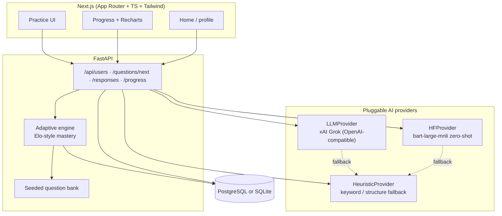

# Adaptive Learning for Critical Thinking

Portfolio-quality MVP: an AI tutor that presents open-ended critical-thinking scenarios, analyzes free-text answers for **logical fallacies** and **reasoning gaps**, returns **explainable feedback**, and **adapts** the next item’s domain/difficulty from per-skill mastery.

Built for students / freelancers in AI · automation · ML who want a clean, runnable monorepo to show end-to-end product thinking.

## Architecture



**Provider resolution:** if `XAI_API_KEY` or `LLM_API_KEY` is set → **Grok**; else if `transformers`+`torch` importable → **HF**; else → **heuristic**. HF model loads lazily; if download fails, the app degrades to heuristic without crashing.

## Stack

| Layer | Tech |
|-------|------|
| Backend | Python 3.12+, FastAPI, SQLAlchemy, Pydantic v2 |
| DB | PostgreSQL (docker-compose) or SQLite (`DATABASE_URL`) |
| AI | xAI Grok via OpenAI-compatible Chat Completions; optional Hugging Face Transformers |
| Frontend | Next.js 15 App Router, TypeScript, Tailwind, Recharts |
| Tests | pytest (adaptive engine + heuristic) |

## xAI Grok configuration

Defaults target xAI’s API ([docs.x.ai](https://docs.x.ai)):

| Variable | Default | Notes |
|----------|---------|-------|
| `LLM_BASE_URL` | `https://api.x.ai/v1` | OpenAI-compatible base |
| `XAI_API_KEY` | _(empty)_ | Preferred key name ([console.x.ai](https://console.x.ai)) |
| `LLM_API_KEY` | _(empty)_ | Also accepted if `XAI_API_KEY` unset |
| `LLM_MODEL` | `grok-4.7` | Flagship model; see [models](https://docs.x.ai/docs/models) |

Feedback (and optional generation) uses Chat Completions with `response_format: {"type":"json_object"}`. xAI also supports stricter `json_schema` structured outputs — see [Structured Outputs](https://docs.x.ai/developers/model-capabilities/text/structured-outputs).

Set `LLM_GENERATE_QUESTIONS=1` to have `GET /api/questions/next` ask Grok for a fresh item (off by default so practice stays fast on the seeded bank).

## Quick start (local, SQLite + heuristic/Grok)

```bash
# Backend
cd backend
python3 -m venv .venv && source .venv/bin/activate
pip install -r requirements.txt
# Optional live Grok (never commit the key):
export XAI_API_KEY=...          # from your environment
# export LLM_MODEL=grok-4.7     # default
uvicorn app.main:app --reload --port 8000

# Frontend (other terminal)
cd frontend
npm install
NEXT_PUBLIC_API_URL=http://localhost:8000 npm run dev
```

Open http://localhost:3000 — create a learner, practice, view progress.

### API smoke test

```bash
curl -s http://localhost:8000/api/health | jq
curl -s -X POST http://localhost:8000/api/users \
  -H 'Content-Type: application/json' \
  -d '{"display_name":"demo"}' | jq
# use returned id:
curl -s 'http://localhost:8000/api/questions/next?user_id=1' | jq
curl -s -X POST http://localhost:8000/api/responses \
  -H 'Content-Type: application/json' \
  -d '{"user_id":1,"question_id":1,"answer_text":"The claim is weak because the evidence is only correlational; a key assumption is that no confounders exist."}' | jq
curl -s http://localhost:8000/api/progress/1 | jq
```

### Tests

```bash
cd backend && source .venv/bin/activate
pytest -q
```

## Docker Compose

```bash
cp .env.example .env   # add XAI_API_KEY if desired — do not commit .env
docker compose up --build
```

- Frontend: http://localhost:3000  
- API docs: http://localhost:8000/docs  
- Postgres: `localhost:5432` (`ct` / `ct` / `critical_thinking`)

## Project layout

```
critical-thinking-app/
├── backend/
│   ├── app/
│   │   ├── ai/           # provider interface, llm (Grok), hf, heuristic
│   │   ├── api/          # FastAPI routers
│   │   ├── models/       # SQLAlchemy: User, SkillDomain, Question, …
│   │   ├── services/     # adaptive engine, question bank, learning flow
│   │   └── main.py
│   ├── tests/
│   └── requirements.txt
├── frontend/             # Next.js App Router
├── docker-compose.yml
├── .env.example
└── README.md
```

## Skill domains (MVP)

1. Argument analysis  
2. Fallacy detection  
3. Evidence evaluation  
4. Assumptions  
5. Causal reasoning  

## Roadmap (not in MVP)

- [ ] Resource recommendations keyed to detected gaps  
- [ ] Richer progress dashboards (streaks, radar charts, export)  
- [ ] Argument scaffolding / guided outlines before free writing  
- [ ] Educator module (classes, assignments, anonymized analytics)  
- [ ] Auth (OAuth / magic link) and multi-device sync  
- [ ] Stricter xAI `json_schema` response formats + eval harness  
- [ ] Spaced repetition over weak fallacies  

## License

MIT — use freely in portfolios and client demos.
