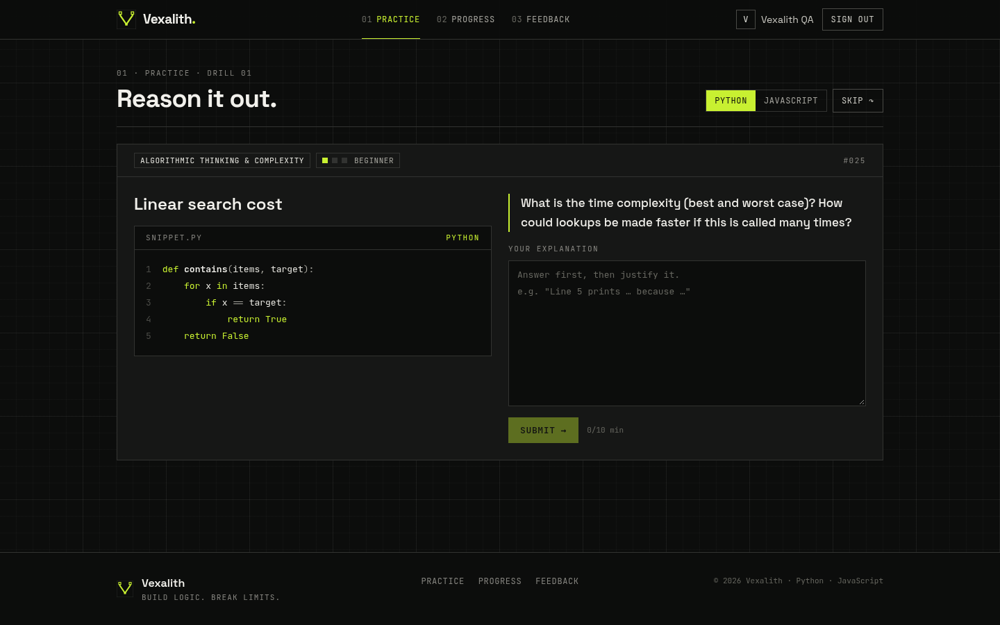
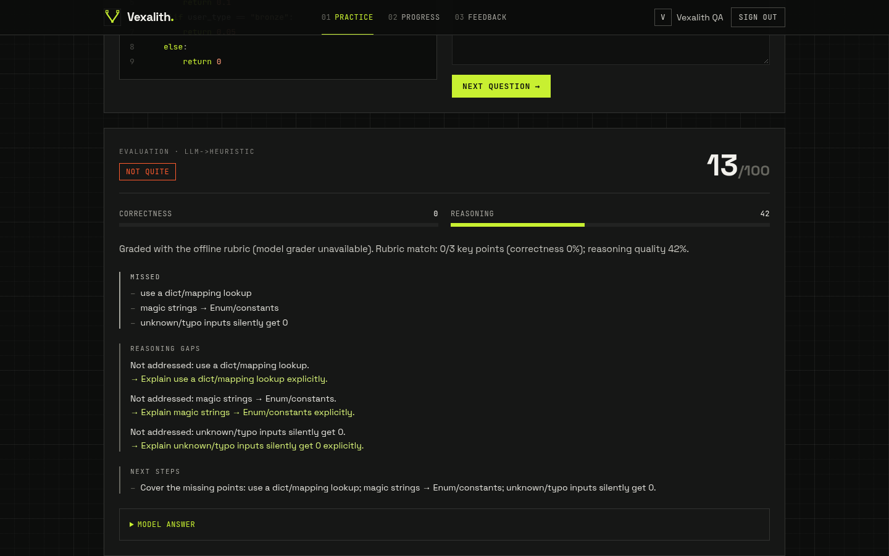
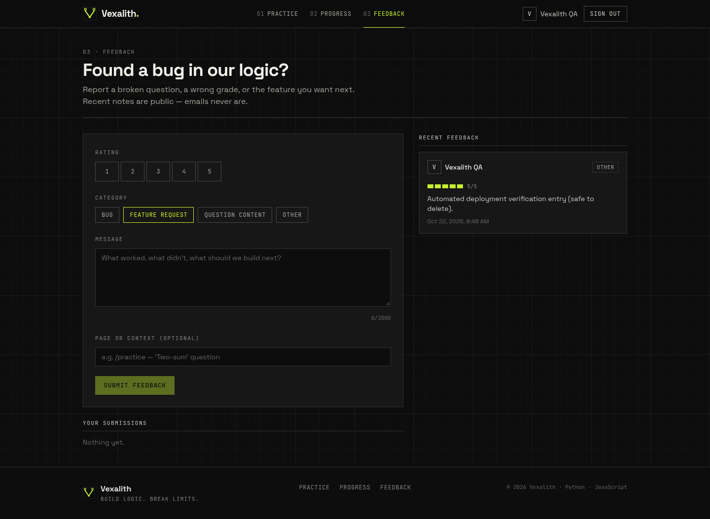
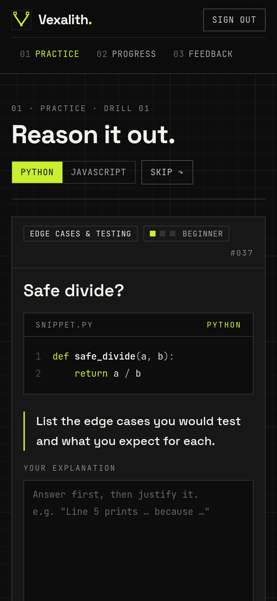
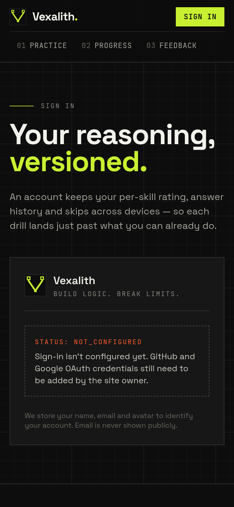

<p align="center">
  
</p>

<h1 align="center">Vexalith</h1>
<p align="center"><strong>Build Logic. Break Limits.</strong></p>
<p align="center">
  Reasoning drills for programmers. Read real Python or JavaScript, then predict the output, find the bug, defend the Big-O, or review the design.<br/>
  Each answer gets two grades: <em>is it correct</em> and <em>is the reasoning sound</em>.
</p>
<p align="center">
  <a href="https://vexalith-app.vercel.app"><strong>Live demo → vexalith-app.vercel.app</strong></a>
</p>


## What it does

| | |
|---|---|
| **6 skills** | Code tracing · Debugging · Algorithmic thinking & complexity · Edge cases & testing · Code review & design · Data structures |
| **72 questions** | 3 levels (beginner → advanced) × 2 languages (Python, JavaScript), syntax-highlighted |
| **Explainable grading** | Correctness (70%) + reasoning (30%) − misconception penalties. Shows what held up, what you missed, any misconceptions and a model answer |
| **Adaptive** | An Elo-style mastery rating per skill picks the next skill and difficulty. Recently seen questions are excluded. Skipping is recorded but only nudges mastery (−0.01) |
| **Accounts** | Sign in with GitHub or Google (Auth.js v5). Practice, progress and history are tied to your account |
| **Feedback wall** | Signed-in users send rated feedback. A public wall shows recent entries (never emails). Rate limits, duplicate checks and spam checks run on the server |

<table>
  <tr>
    <td></td>
    <td></td>
  </tr>
  <tr>
    <td></td>
    <td></td>
  </tr>
</table>

<p align="center">
  
  &nbsp;
  
</p>

## Architecture

```
Browser ──► Next.js 15 (Vercel)                         FastAPI (Vercel Python)
            ├─ Auth.js v5 (GitHub / Google, JWT session)
            ├─ /api/backend/* allow-listed proxy ──────► verifies HS256 JWT (iss/aud/exp ≤ 15 min)
            │    mints 5-minute HS256 JWT per request    ├─ users upserted by (provider, account id)
            └─ middleware: protects /practice, /progress ├─ adaptive engine (Elo mastery)
                                                         ├─ grader: LLM (JSON) → rubric fallback
                                                         └─ SQLAlchemy ──► Neon Postgres
```

* The browser never talks to the API directly and never sends a user id. The Next.js server takes the user's identity from the Auth.js session and signs a short-lived token. The API reads the user from that token only.
* **Grading.** If an OpenAI-compatible model is configured (xAI Grok by default), it returns structured JSON feedback. If the model is missing or fails, a deterministic rubric grader takes over: keyword concepts, misconception rules and a reasoning-quality score. After an auth or quota failure a circuit breaker skips the model for 5 minutes so requests stay fast.
* **Schema versioning.** On startup the API compares a stored schema version. If it changed, the API migrates and reseeds under a Postgres advisory lock.

## Stack

**Frontend:** Next.js 15 (App Router) · React 19 · TypeScript · Tailwind CSS · Auth.js (next-auth v5) · jose · prism-react-renderer · Space Grotesk + JetBrains Mono. Animations are CSS-only and respect `prefers-reduced-motion`.<br/>
**Backend:** FastAPI · SQLAlchemy 2 · Pydantic v2 · PyJWT · httpx · pytest<br/>
**Infra:** Vercel (two projects) · Neon Postgres

## Run locally

```bash
# 1) Secrets (one-time)
export BACKEND_JWT_SECRET=$(openssl rand -base64 48)
export AUTH_SECRET=$(openssl rand -base64 48)

# 2) API on :8000 (SQLite by default)
cd backend
python -m venv .venv && . .venv/bin/activate
pip install -r requirements.txt -r requirements-dev.txt
uvicorn app.main:app --reload
pytest -q                       # 32 tests

# 3) Web on :3000 (in another shell, same exports)
cd frontend
npm install
BACKEND_URL=http://localhost:8000 AUTH_URL=http://localhost:3000 npm run dev
```

Or run everything with Postgres: `docker compose up --build` (it requires `AUTH_SECRET` and `BACKEND_JWT_SECRET` in your environment).

To enable sign-in, create OAuth apps and set `AUTH_GITHUB_ID` / `AUTH_GITHUB_SECRET` and/or `AUTH_GOOGLE_ID` / `AUTH_GOOGLE_SECRET`. Each provider is enabled only when both of its values are set. With neither set, `/login` says that sign-in isn't configured yet.

| Provider | Homepage URL | Callback URL |
|---|---|---|
| GitHub | `https://<your-domain>` | `https://<your-domain>/api/auth/callback/github` |
| Google | `https://<your-domain>` | `https://<your-domain>/api/auth/callback/google` |

All variables are listed in [`.env.example`](.env.example).

## API (selected)

| Method | Path | Auth |
|---|---|---|
| GET | `/api/health` | public |
| GET | `/api/me` | JWT |
| GET | `/api/questions/next?language=python&exclude=1,2` | JWT |
| POST | `/api/questions/{id}/skip?language=python` | JWT |
| POST | `/api/responses` `{question_id, answer_text}` | JWT |
| GET | `/api/progress` | JWT |
| POST / GET | `/api/feedback` · `/api/feedback/mine` | JWT |
| GET | `/api/feedback/recent` | public (no emails) |

`scripts/smoke_api.sh` mints a test token from `BACKEND_JWT_SECRET` and runs the whole flow.

`POST /api/admin/purge-users` deletes specific users (by `provider:account_id`) and everything they own. It returns 404 unless the sensitive `ADMIN_TOKEN` env var (32+ chars) is set, and it needs that token in the `X-Admin-Token` header. Requests default to a dry run.

## Deploy (Vercel)

Create two projects: root `backend/` (Python) and root `frontend/` (Next.js). Then set:

* **Backend:** `DATABASE_URL` (Neon), `BACKEND_JWT_SECRET` (sensitive), `CORS_ORIGINS`, optional `XAI_API_KEY` (sensitive)
* **Frontend:** `AUTH_SECRET` (sensitive), `BACKEND_JWT_SECRET` (sensitive, same value), `BACKEND_URL`, `AUTH_URL`, `NEXT_PUBLIC_SITE_URL`, and the OAuth IDs and secrets

## License

[MIT](LICENSE)
