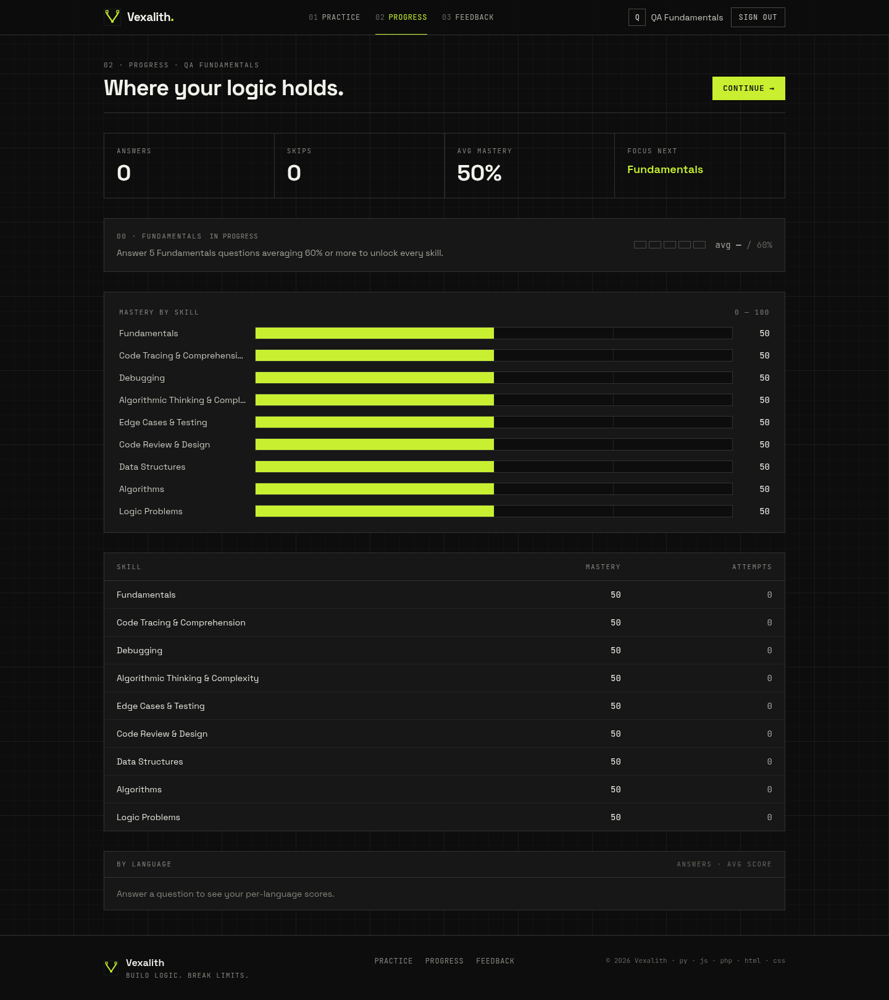
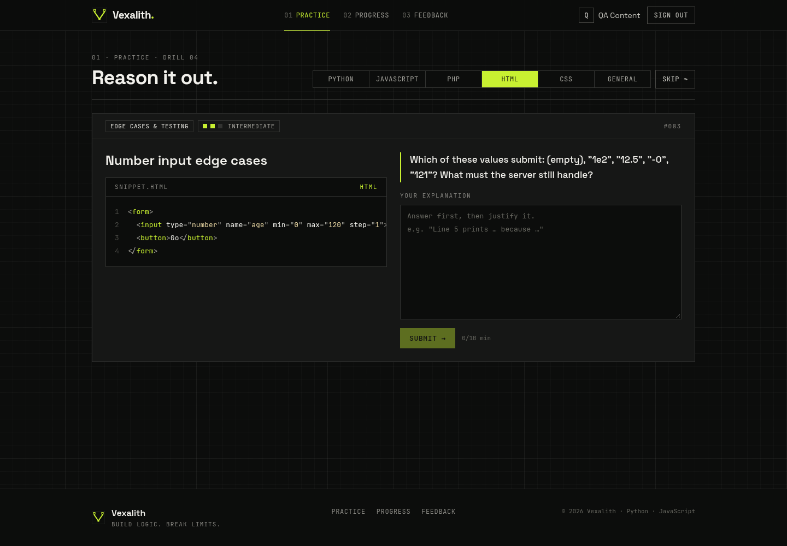
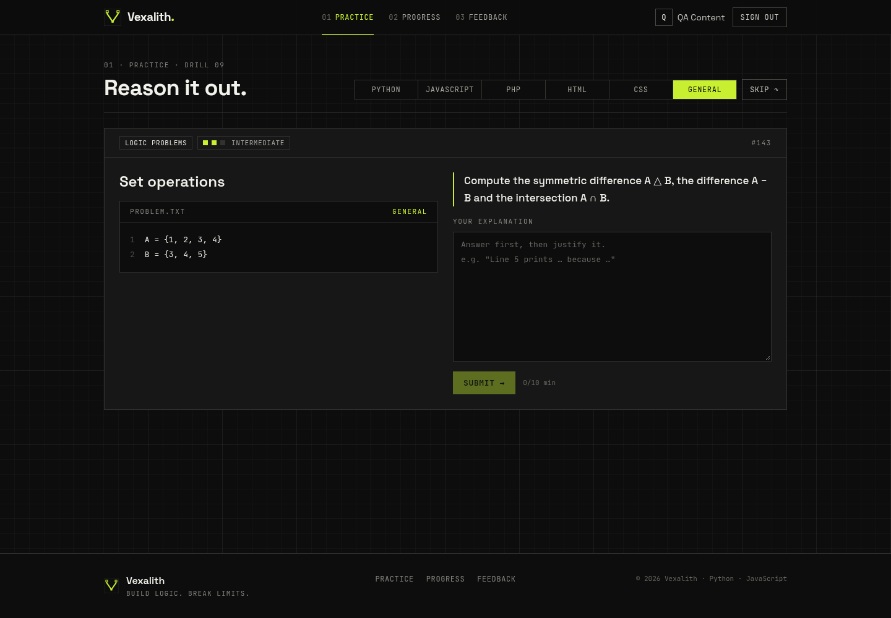

# Vexalith: advanced documentation

This page is for people who want to change, deploy or integrate Vexalith. For a gentle introduction, start with the [README](../README.md).

## Architecture

```
Browser ──► Next.js 15 (Vercel)                         FastAPI (Vercel Python)
            ├─ Auth.js v5 (GitHub / Google, JWT session)
            ├─ /api/backend/* allow-listed proxy ──────► verifies HS256 JWT (iss/aud/exp ≤ 15 min)
            │    mints 5-minute HS256 JWT per request    ├─ users upserted by (provider, account id)
            └─ middleware: protects /practice, /progress ├─ adaptive engine (Elo mastery)
                                                         ├─ grader: LLM (JSON) → rubric fallback
                                                         └─ SQLAlchemy ──► Neon Postgres / SQLite
```

- **Identity.** The browser never talks to the API directly and never sends a user id. The Next.js server reads the identity from the Auth.js session and signs a short-lived token (`iss=vexalith-web`, `aud=vexalith-api`, `sub=provider:account_id`). The API trusts only that token.
- **Grading.** If an OpenAI-compatible model is configured (xAI Grok by default), it returns structured JSON feedback. If the model is missing or fails, a deterministic rubric grader takes over: keyword concepts, misconception rules and a reasoning-quality score (`overall = 0.7 × correctness + 0.3 × reasoning − 0.12 per misconception`). After an auth or quota failure, a circuit breaker skips the model for 5 minutes.
- **Adaptive engine.** Mastery per skill is an Elo-style rating. The next skill is the weakest one that has questions in the chosen language. Equal skills rotate round-robin, recently seen questions are excluded, and skips only nudge mastery (−0.01).
- **Fundamentals onboarding.** New learners get Fundamentals first. They start at level 1, then move to level 2 after 3 strong answers (score ≥ 60%) and level 3 after 6. After 5 Fundamentals answers averaging ≥ 60%, or 3 answers in other skills, the weakest-first engine takes over and still revisits Fundamentals if it becomes the weakest skill. `focus=fundamentals` restricts practice to Fundamentals.
- **Content and seeding.** Questions live in `backend/app/content/`. Each one has a rubric: concepts with keywords and weights, misconceptions, and a reference answer. On startup they are upserted by `(title, language)` and skills by `slug`, so new content never touches user data. Fill-in-the-missing-code questions are built with `FB()` in `app/content/qdef.py`: the snippet holds one `____` blank and the rubric stores `kind: "fill_blank"` plus `accepted_answers`, which the offline grader matches ignoring whitespace, case, quote style and semicolons (respecting identifier boundaries). The API returns `kind` on each question, and fill-blank answers may be a single character long (explanations still need 10). A stored schema version triggers a migration and reseed only when the version changes, under a Postgres advisory lock.

## Stack

- **Frontend:** Next.js 15 (App Router) · React 19 · TypeScript · Tailwind CSS · Auth.js (next-auth v5) · jose · prism-react-renderer + prismjs (PHP grammar; C++ uses the bundled `cpp` grammar) · Space Grotesk + JetBrains Mono. Animations are CSS-only and respect `prefers-reduced-motion`.
- **Backend:** FastAPI · SQLAlchemy 2 · Pydantic v2 · PyJWT · httpx · pytest.
- **Infra:** Vercel (two projects) · Neon Postgres.

## API

| Method | Path | Auth |
|---|---|---|
| GET | `/api/health` | public |
| GET | `/api/me` | JWT |
| GET | `/api/questions/next?language=python&exclude=1,2&focus=fundamentals` | JWT |
| POST | `/api/questions/{id}/skip?language=python&focus=fundamentals` | JWT |
| POST | `/api/responses` `{question_id, answer_text}` | JWT |
| GET | `/api/progress` (skills, per-language scores, fundamentals status) | JWT |
| GET / POST | `/api/xp` (level, badges, recent XP) · `/api/xp/sync` (count new work, return what to toast once) | JWT |
| GET | `/api/leaderboard?period=week\|all` (top 50 + your rank; weeks start Monday 00:00 Asia/Manila; never emails) | JWT |
| GET / PUT / POST | `/api/xp/profile` `{visibility: handle\|name\|anonymous\|hidden}` · `/api/xp/profile/handle` (new random handle) | JWT |
| GET | `/api/paths` (every learning path with progress, plus the step to continue) · `/api/paths/{slug}` (one path, each step locked / open / done) | JWT |
| GET | `/api/paths/{slug}/steps/{n}/next?exclude=1,2` (an adaptive question from that step; answer it with `POST /api/responses`) | JWT |
| POST | `/api/paths/{slug}/steps/{n}/skip-ahead` (open a locked step early; remembered in `path_skips`) | JWT |
| POST / GET | `/api/feedback` · `/api/feedback/mine` | JWT |
| GET | `/api/feedback/recent` | public (no emails) |
| GET | `/api/languages` · `/api/domains` · `/api/catalog` (question counts per language and kind, no content) | public |

- `language` is one of `python`, `javascript`, `php`, `cpp` (C++), `html`, `css` or `general`. `focus` is optional and currently accepts only `fundamentals`.
- `scripts/smoke_api.sh` mints a test token from `BACKEND_JWT_SECRET` and runs the whole flow against a running API.
- `POST /api/admin/purge-users` deletes specific users (by `provider:account_id`) and everything they own. It returns 404 unless the sensitive `ADMIN_TOKEN` env var (32+ characters) is set, and it needs that token in the `X-Admin-Token` header. Requests default to a dry run. Remove `ADMIN_TOKEN` after use.

## Environment variables

All variables are listed with comments in [`.env.example`](../.env.example).

| Variable | Where | Purpose |
|---|---|---|
| `DATABASE_URL` | backend | SQLite by default; a `postgresql://` URL in production |
| `BACKEND_JWT_SECRET` | backend + frontend | Shared secret for the short-lived API tokens (same value on both) |
| `CORS_ORIGINS` | backend | Allowed browser origins |
| `XAI_API_KEY`, `LLM_BASE_URL`, `LLM_MODEL` | backend | Optional model grader |
| `ADMIN_TOKEN` | backend | Optional; enables the purge endpoint while set |
| `AUTH_SECRET` | frontend | Encrypts Auth.js sessions |
| `AUTH_URL`, `NEXT_PUBLIC_SITE_URL` | frontend | Public site URL |
| `BACKEND_URL` | frontend | Where the server-side proxy sends API calls |
| `AUTH_GITHUB_ID`, `AUTH_GITHUB_SECRET` | frontend | GitHub sign-in (enabled only when both are set) |
| `AUTH_GOOGLE_ID`, `AUTH_GOOGLE_SECRET` | frontend | Google sign-in (enabled only when both are set) |
| `PRIMARY_HOST` | frontend | Optional; 308-redirects other hosts to this one |

## OAuth apps

| Provider | Homepage URL | Callback URL |
|---|---|---|
| GitHub | `https://<your-domain>` | `https://<your-domain>/api/auth/callback/github` |
| Google | `https://<your-domain>` | `https://<your-domain>/api/auth/callback/google` |

## Docker

Run everything with Postgres: `docker compose up --build`. This requires `AUTH_SECRET` and `BACKEND_JWT_SECRET` in your environment.

## Deploy (Vercel)

Create two projects, one with root directory `backend/` (Python) and one with root `frontend/` (Next.js). Then set:

- **Backend:** `DATABASE_URL` (Neon), `BACKEND_JWT_SECRET` (sensitive), `CORS_ORIGINS`, optional `XAI_API_KEY` (sensitive).
- **Frontend:** `AUTH_SECRET` (sensitive), `BACKEND_JWT_SECRET` (sensitive, same value), `BACKEND_URL`, `AUTH_URL`, `NEXT_PUBLIC_SITE_URL`, and the OAuth IDs and secrets.

## Screenshots

<table>
  <tr>
    <td></td>
    <td></td>
  </tr>
  <tr>
    <td></td>
    <td></td>
  </tr>
</table>
